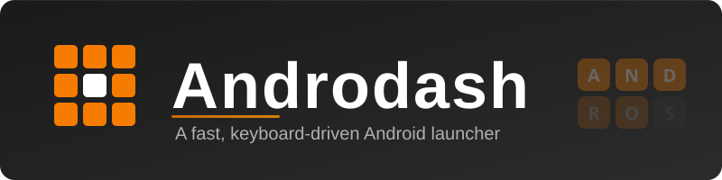

  

  <b>A fast, keyboard-driven Android launcher with letter-based navigation.</b>

Androdash filters your apps by tapping or typing letters instead of scrolling
through a grid. Built for minimal, low-distraction use on phones, tablets, and
devices with hardware remotes.

## Features

- **Letter navigation** — Tap letters to progressively narrow the app list. Available letters update as you select.
- **Keyboard support** — Start typing to filter. Enter launches the first match, Backspace clears.
- **Match methods** — Switch how typed letters match app names (prefix, contains, and more).
- **Usage-based sorting** — Letters you pick most often move to the front.
- **App history** — A row of recently launched apps for quick re-access.
- **Folders** — Group apps into folders with custom labels and icons.
- **Bookmarks** — Add shortcuts to URLs alongside your apps.
- **Hide apps** — Hide apps from the grid and/or from history, without uninstalling.
- **Long-press menu** — App shortcuts, hide toggles, add to folder, uninstall, and app info.
- **Configurable letterbar** — Place the letter bar on any edge; the grid adapts.
- **Hardware remote** — Navigate focus with a joystick remote; select and back buttons supported.
- **Backup & restore** — Save and restore settings, folders, bookmarks, and hidden apps.
- **Dark theme** — Dark interface with orange accents.
- **Auto-update** — Check for and install nightly builds from the config panel.

## Requirements

- Android 14+ (API 34)

## Installation

1. Download the latest APK from the [Releases](../../releases) page.
2. Install it on your device.
3. When prompted to choose a home app, select **Androdash**.
4. For full app-shortcut access in the long-press menu, set Androdash as your default launcher.

## Configuration

Tap the gear icon (&#9881;) in the letter bar to open the config panel:

| Item | Description |
|------|-------------|
| **Show all Apps** | Reveal hidden apps (shown at reduced opacity) |
| **Lettersort** | Toggle alphabetical vs. usage-based letter ordering |
| **Match** | Cycle through letter-matching methods |
| **Letterbar** | Cycle placement: top / bottom / left / right |
| **App History** | Show or hide the recent apps row |
| **Version** | Show current build; tap to check for updates |
| **Add Bookmark** | Create a URL bookmark |
| **Add Folder** | Create an app folder |
| **Backup** | Back up or restore your configuration |
